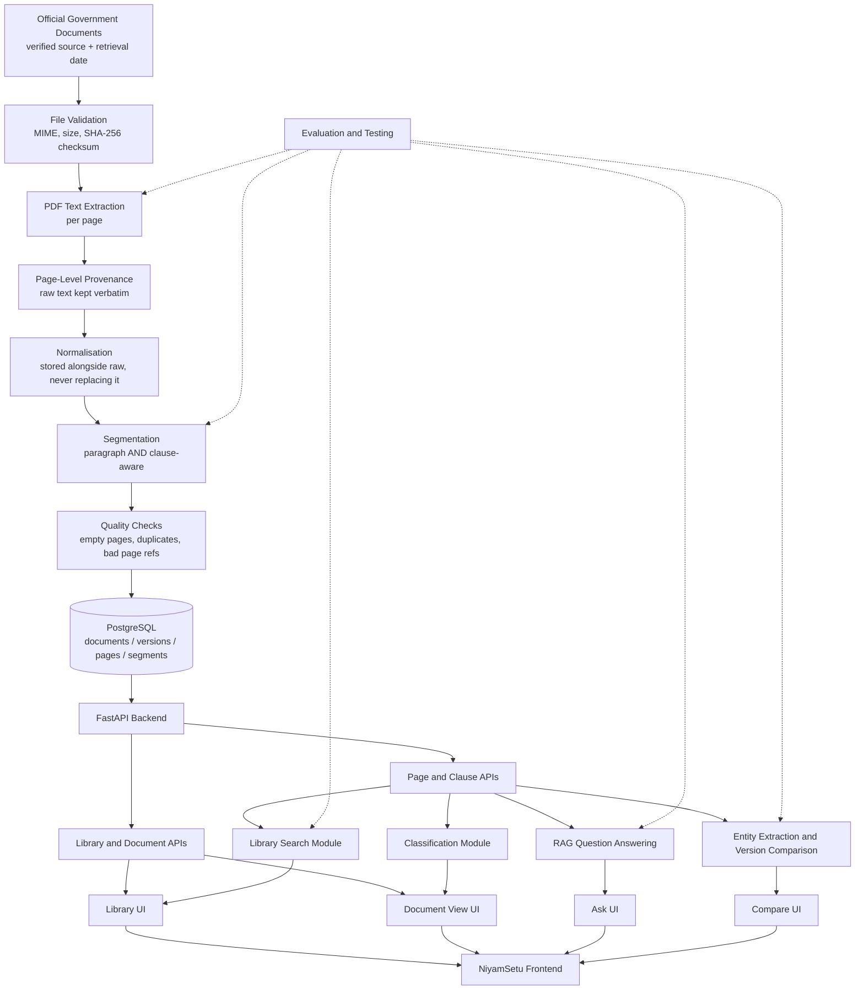
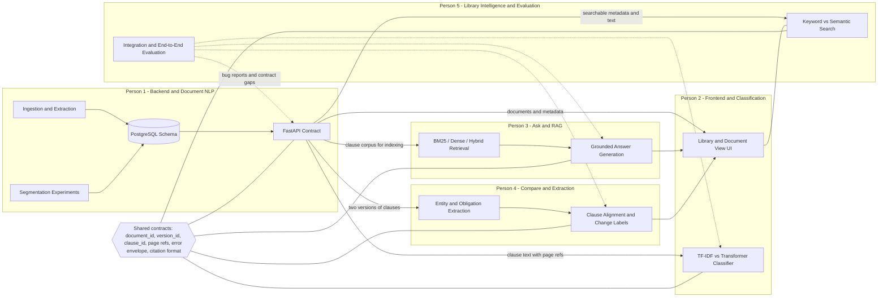
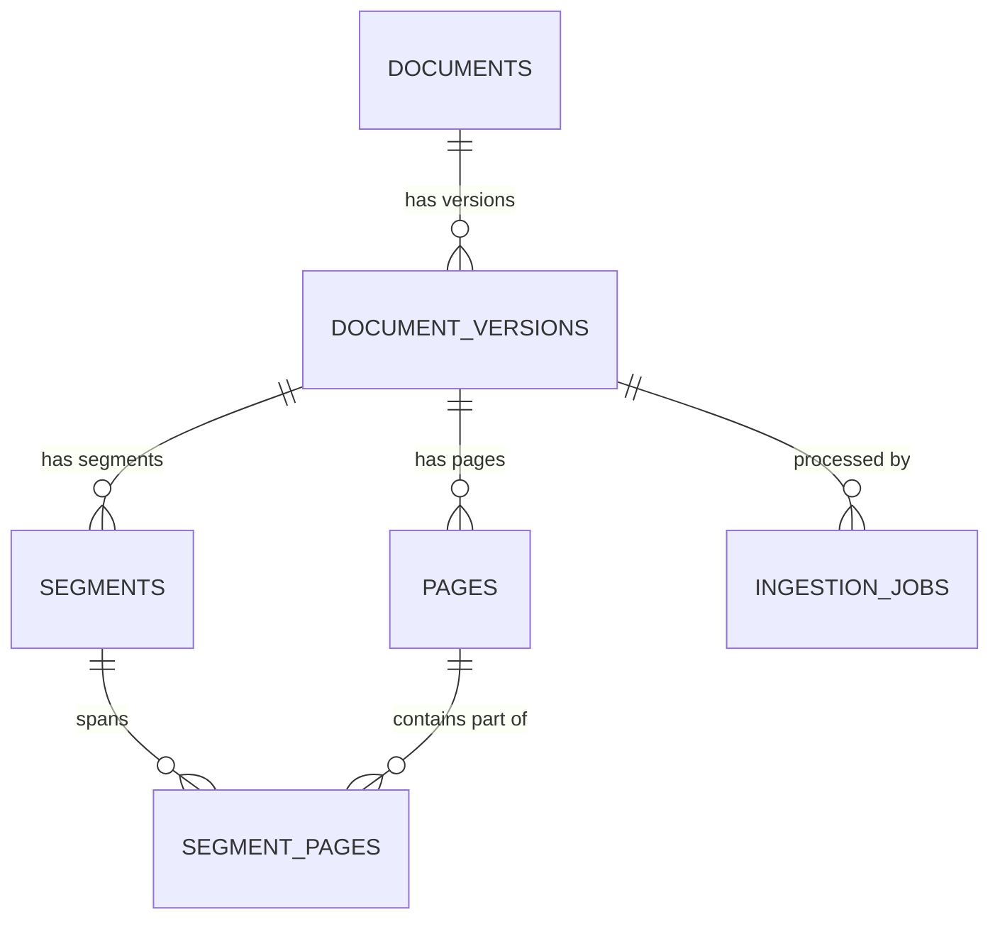

# CLAUDE.md — NiyamSetu Project Reference

> **Audience:** Claude Code sessions, and the five humans on this project.
> **Written:** 2026-10-28, after a full audit of this repository.
> **Owner of this document:** Person 1 (Backend + Document NLP).

---

## 0. Status legend — read this first

Every claim in this file carries one of these labels. If a label is missing, treat the
statement as **[PROPOSED]**.

| Label | Meaning |
|---|---|
| `[IMPLEMENTED]` | Code exists in this repo **and** has been run or tested successfully. |
| `[UNVERIFIED]` | Code exists in this repo but has not been executed or tested. |
| `[PARTIAL]` | Some of the described behaviour exists; the rest does not. |
| `[PLANNED]` | Agreed by the team, not yet built. |
| `[PROPOSED]` | Suggested by this document; **not yet agreed by the team**. |
| `[BLOCKED]` | Cannot proceed until a listed decision is made. |

### Where the project actually is — updated 2026-10-28, after Phase 1

**Phase 1 (PDF ingestion and page-level extraction) is `[IMPLEMENTED]`.** It has
been built, tested (90 passing tests) and run against four real RBI documents.
See §21 for the file-by-file status, `docs/pdf-extraction.md` for the design and
contract, and `evaluation/2026-10-28-phase1-extraction-validation.md` for what
the real-document run actually showed, defects included.

**Everything else below remains `[PROPOSED]` or `[PLANNED]`.** In particular
there is still no database, no FastAPI application, no segmentation, no NLP
module, no frontend, no annotation and no evaluation metric. Do not tell anyone
otherwise.

**Current phase:** Phase 2 — paragraph and clause-aware segmentation.
**Next milestone:** `segments` with page provenance, both methods stored side by
side, plus header/footer removal informed by the validation report §4.6. Four of
the five team members are blocked on this, because clauses are what they consume.

The ordering recommendation has changed slightly on the strength of Phase 1:
**do segmentation before the database.** The schema's hardest part is the segment
tables, and they are easier to design against real segments than against a
sketch (`docs/pdf-extraction.md` §12).

---

## 1. Project identity and summary

**Name:** NiyamSetu — NLP-Powered Government Policy Intelligence System.

NiyamSetu ingests official Indian government policy documents (notifications,
circulars, schemes, guidelines, amendments), extracts their text while keeping
page-level provenance, segments them into clauses, stores them in PostgreSQL,
and exposes four user-facing capabilities: **Library**, **Document View**,
**Ask** (evidence-backed question answering), and **Compare** (policy version
diffing).

One sentence: *NiyamSetu turns official policy PDFs into searchable,
question-answerable, version-comparable records where every output can be traced
back to a document and a page.*

This is a one-month college NLP project for a five-person team. It is graded on
genuine NLP experimentation and honest evaluation, not on feature count.

---

## 2. Problem statement

Government departments publish policy material as PDFs. Those documents are hard
to use because:

- They are often long and written in dense official register.
- Conditions, deadlines, obligations and responsible authorities are scattered
  across sections.
- Finding the one clause that answers a specific question can mean reading the
  whole document.
- Understanding what changed between two versions of a policy means manually
  comparing two long documents side by side.
- A generic LLM asked about a policy can produce an answer that no source
  supports, with no way for the reader to check it.

**Scope discipline:** we address *navigability, searchability, comparability and
traceability* for a small, curated document collection. We do not claim to solve
government communication, and we do not quantify the size of the problem without
a citation.

---

## 3. Project objectives

1. Ingest official policy documents from verified sources.
2. Extract text while preserving document structure and page references.
3. Organise documents, versions, pages and clauses in a searchable database.
4. Classify and retrieve relevant documents.
5. Answer questions using evidence retrieved from the actual documents.
6. Extract important entities: dates, deadlines, departments, authorities, obligations.
7. Compare two versions of a policy and identify what changed.
8. Present evidence and source references so a user can verify every output.

Priority order when time runs short: **reliability and traceability > breadth of
features.** A smaller system whose outputs can all be verified scores better than
a broad system that cannot be trusted.

---

## 4. Intended users and product capabilities

| User | What they need from NiyamSetu |
|---|---|
| Citizen / applicant | A plain answer to "does this apply to me, what must I do, by when" — with the source clause shown. |
| Department official | Fast location of the governing clause; what changed in the latest amendment. |
| Student / researcher | A structured, citable corpus of policy text with clause-level references. |
| Business / compliance reader | Detection of changed obligations and deadlines between versions. |

Capabilities, in the order we intend to deliver them:

1. Document library with metadata, search and filters.
2. Document view with extracted text, pages and clauses.
3. Evidence-backed question answering over the corpus.
4. Entity and obligation extraction surfaced on the document view.
5. Version comparison with clause-level added / removed / modified labels.

The `README.md` in this repository additionally describes **simple-language mode**
and **Hindi / Punjabi output**. Those are `[PROPOSED]` and **not yet scoped** —
see §22.2, Open Decision D-3.

---

## 5. The four interface areas

### 5.1 Library
Browse the document collection; search by title, keyword and available metadata;
filter by department, document type and date where the data supports it; show
recently added documents; open a document.
Owner: Person 2 (UI) with Person 5 (search).

### 5.2 Document View
Document title and metadata; extracted text; page references; detected clauses
and headings; extracted entities, dates, deadlines and obligations where
extraction supports them; a visible path from any extracted item back to its
source page.
Owner: Person 2, consuming Person 1's APIs and Person 4's extraction.

### 5.3 Ask
Natural-language question → retrieved passages → an answer grounded in those
passages → displayed document and page citations. Must state plainly when the
retrieved evidence is insufficient instead of answering anyway.
Owner: Person 3.

### 5.4 Compare
Select two versions (or two related documents) → align clauses where possible →
report added / removed / modified clauses → show old and new text → explain the
change → cite document and page. Uncertain clause matches must be visually
distinguished from confident ones.
Owner: Person 4.

**Hard UI rule:** the Compare view must never present a speculative change as a
verified fact, and the Ask view must never show a citation whose text does not
support the statement.

---

## 6. The main differentiator

**Evidence-backed policy intelligence, with policy version comparison as the
headline capability.**

This project is not "PDF → RAG → chatbot". What makes it defensible in a viva:

- Every clause retains a stable identifier and page provenance through the
  entire pipeline.
- Ask answers are checked for citation correctness, not just fluency.
- Compare performs clause alignment and change classification — a real NLP task
  with a real evaluation — rather than a character-level text diff.
- We measure paragraph-based vs clause-aware segmentation and report its effect
  on downstream retrieval.

Compare is explicitly allowed to be a **stretch feature**. If the core
ingestion → storage → API → Ask path is not solid, we do not sacrifice it to
demo Compare.

---

## 7. Team responsibilities (summary)

Full detail, deliverables and dependencies: **`docs/team-responsibilities.md`**.

| # | Person | Implementation | NLP |
|---|---|---|---|
| 1 | **Me (owner of this file)** | FastAPI backend, PostgreSQL schema, PDF ingestion, document/clause APIs, tests | PDF extraction quality, paragraph vs clause-aware segmentation, page provenance, dataset + data-quality evaluation |
| 2 | Frontend | Streamlit UI, Library, Document View, navigation, loading/error/empty states | Document classification: TF-IDF baseline vs pretrained Transformer; optional clustering; optional Hindi generation prototype |
| 3 | Ask | Ask feature end-to-end, evidence display | IR baseline, BM25 vs dense vs hybrid, chunking effect, RAG pipeline, citation correctness, unanswerable-question handling |
| 4 | Compare | Compare interface, version selection, aligned clause display | Entity / date / deadline / authority / obligation extraction (rule-based baseline vs statistical or pretrained), clause alignment, change classification |
| 5 | Library intelligence + integration | Library search and filters, frontend↔backend integration, integration and regression tests | Keyword vs semantic/hybrid document search, search relevance evaluation, error-propagation analysis, shared evaluation procedure, end-to-end report |

Person 5 has real implementation and NLP deliverables. Person 5 is not a project
manager.

---

## 8. My detailed responsibilities — Backend + Document NLP

### 8.1 Backend engineering
- Document the repository architecture (this file; done for the audit stage).
- Build the FastAPI application.
- Design and create the PostgreSQL schema.
- Model documents, versions, pages and clauses, including version metadata.
- Build PDF ingestion and text extraction.
- Preserve page-level source references through every transformation.
- Store extracted page text and segmented clauses.
- Expose APIs for ingestion, listing, metadata, page content and clause retrieval.
- Add input validation, structured logging, exception handling and automated tests.
- Publish and version the API contract that the other four consume.

### 8.2 Document NLP
- Measure PDF text-extraction quality on our real documents (Experiment A, §15).
- Handle headers/footers, multi-column layout, tables, page breaks, ligature and
  spacing artefacts.
- Implement paragraph segmentation, then clause-aware segmentation (Experiment B).
- Investigate how headings, clause numbering and page breaks affect boundaries.
- Keep every clause linked to its document, version and page range.
- Produce a reusable document + clause dataset for the team.
- Define and document the evaluation methodology and annotation guidelines.
- Manually inspect a sample and report real extraction and segmentation errors.

### 8.3 My deliverables
1. Working ingestion pipeline (PDF → pages → clauses → DB).
2. PostgreSQL schema with a reproducible setup path.
3. Page-aware extracted content, with original text retained separately from
   normalised text.
4. Stored clauses with stable IDs and page provenance.
5. Documented and tested FastAPI endpoints.
6. A written comparison of paragraph vs clause-aware segmentation, with numbers
   from a real annotated sample.
7. Dataset documentation (`data/README.md`).
8. Data-quality and extraction evaluation report (`evaluation/`).
9. Integration instructions for Persons 2–5.

Build these **incrementally**, in the phase order of `docs/backend-roadmap.md`.
Do not attempt the whole backend in one pass.

---

## 9. Overall system architecture

Layered, single-repository, no distributed components:

1. **Source layer** — curated official PDFs, each recorded with its origin URL
   and retrieval date.
2. **Ingestion layer** — file validation, checksum, text extraction,
   normalisation, segmentation, quality checks. Python, invoked by the API or by
   a CLI script.
3. **Storage layer** — PostgreSQL: documents, versions, pages, segments
   (clauses), ingestion jobs.
4. **API layer** — FastAPI. The *only* way the other four modules read document data.
5. **NLP layer** — four independent Python packages (classification, rag_qa,
   extraction_diff, library_search) that consume the API, or the DB read-only,
   and return JSON.
6. **Presentation layer** — Streamlit frontend with the four interface areas.
7. **Evaluation layer** — scripts and reports measuring extraction,
   segmentation, retrieval, extraction accuracy and end-to-end behaviour.

Rules that keep the layers honest:
- The frontend never talks to PostgreSQL directly.
- NLP modules never write to the document / version / page / segment tables.
- Nothing downstream of extraction is allowed to drop a page reference.

### 9.1 System flow diagram

All nodes below are `[PROPOSED]` / `[PLANNED]`. None are built yet.



### 9.2 Team ownership and integration points



---

## 10. My backend architecture

```text
Official PDF
  -> file validation            (extension, MIME sniff, size cap, SHA-256)
  -> duplicate check            (checksum lookup against document_versions)
  -> PDF text extraction        (per page, raw text verbatim)
  -> page-wise text records     (version_id, page_number, raw_text)
  -> normalisation              (normalized_text stored as a separate column)
  -> paragraph segmentation     (method = 'paragraph')
  -> clause-aware segmentation  (method = 'clause_aware')
  -> quality checks             (empty pages, page-ref validity, duplicate segments)
  -> PostgreSQL storage         (one transaction per ingested version)
  -> FastAPI endpoints
  -> Persons 2-5
```

### 10.1 Provenance fields to preserve

Carried through the pipeline wherever the source supplies them. **Only the
starred fields are mandatory**; the rest are nullable, because real documents
often omit them.

- **Document / version level:** `document_id`\*, `version_id`\*,
  `original_filename`\*, `file_checksum`\*, `title`\*, `department_or_authority`,
  `document_type`, `publication_date`, `source_url`, `retrieved_at`,
  `extraction_status`\*, `ingested_at`\*, `page_count`\*, `processing_warnings`.
- **Page level:** `page_number`\*, `raw_text`\*, `normalized_text`,
  `char_count`\*, `is_empty`\*.
- **Clause level:** `clause_id`\*, `segmentation_method`\*, `ordinal`\*,
  `clause_number`, `heading`, `text`\*, `page_start`\*, `page_end`\*, plus
  per-page offsets for multi-page clauses (§11.4).

### 10.2 Non-negotiable backend rules
- **Never overwrite `raw_text` with normalised text.** Normalisation is additive.
- **Never produce a clause without a page range.** If the page cannot be
  determined, ingestion fails loudly rather than storing a guessed page.
- **Never put credentials in source.** The DB URL comes from the environment
  (`.env`, git-ignored; `.env.example` committed with placeholders).
- **One version per transaction.** A partially-ingested version must not be
  visible to the APIs; `extraction_status` gates visibility.

---

## 11. Database design `[PROPOSED]`

No schema exists in the repository, so nothing is being replaced. PostgreSQL is
the intended database.

### 11.1 The five entities, and why they are distinct

| Entity | What it is | What it is **not** |
|---|---|---|
| `documents` | A *logical* policy, scheme or notification identity. | Not a file, not a version. |
| `document_versions` | One published issue or amendment of that logical document. | Not an upload event. |
| source file | A physical PDF, identified by SHA-256. Modelled as columns on `document_versions`. | Not a version by itself — the same file could be re-uploaded. |
| `pages` | One page of one version's extracted text. | Not a logical section. |
| `segments` | One paragraph or clause extracted from one version under one segmentation method. | Not a page, and not unique across methods. |

Two rules follow:
- **Similar titles do not imply a version relationship.** Linking a new version
  to an existing `documents` row is a **human decision recorded in metadata at
  ingestion time**, never inferred from string similarity.
- **Publication date does not establish version order reliably.** `version_label`
  and an explicit `supersedes_version_id` carry the ordering; publication date is
  a sortable hint only, and may be null.

### 11.2 Relationships



`document_versions.supersedes_version_id` is a nullable self-reference on the
same table (one version optionally supersedes one other).

### 11.3 Proposed tables

Illustrative DDL sketch, to be reviewed before Phase 3.

```sql
-- A logical policy identity.
CREATE TABLE documents (
  id              BIGSERIAL PRIMARY KEY,
  public_id       TEXT UNIQUE NOT NULL,   -- e.g. 'DOC-0001'; stable, used in APIs
  title           TEXT NOT NULL,
  department      TEXT,                   -- nullable: not always stated
  document_type   TEXT,                   -- notification | circular | scheme | guideline | amendment | other
  reference_no    TEXT,                   -- official notification number, when printed
  created_at      TIMESTAMPTZ NOT NULL DEFAULT now()
);

-- One published issue of that policy.
CREATE TABLE document_versions (
  id                    BIGSERIAL PRIMARY KEY,
  public_id             TEXT UNIQUE NOT NULL,   -- e.g. 'VER-0001'
  document_id           BIGINT NOT NULL REFERENCES documents(id) ON DELETE RESTRICT,
  version_label         TEXT NOT NULL,          -- human-assigned, e.g. 'v1', '2026 amendment'
  supersedes_version_id BIGINT REFERENCES document_versions(id),
  publication_date      DATE,                   -- nullable
  source_url            TEXT,
  retrieved_at          TIMESTAMPTZ,
  original_filename     TEXT NOT NULL,
  stored_path           TEXT NOT NULL,
  file_checksum         CHAR(64) NOT NULL UNIQUE,  -- SHA-256; duplicate detection
  page_count            INTEGER NOT NULL,
  extraction_status     TEXT NOT NULL,          -- pending | ok | partial | failed
  extraction_tool       TEXT NOT NULL,          -- library + version actually used
  processing_warnings   JSONB NOT NULL DEFAULT '[]',
  ingested_at           TIMESTAMPTZ NOT NULL DEFAULT now(),
  UNIQUE (document_id, version_label)
);

-- Page-level extracted text.
CREATE TABLE pages (
  id              BIGSERIAL PRIMARY KEY,
  version_id      BIGINT NOT NULL REFERENCES document_versions(id) ON DELETE CASCADE,
  page_number     INTEGER NOT NULL CHECK (page_number >= 1),
  raw_text        TEXT NOT NULL,          -- verbatim, never rewritten
  normalized_text TEXT,
  char_count      INTEGER NOT NULL,
  is_empty        BOOLEAN NOT NULL,
  UNIQUE (version_id, page_number)
);

-- Paragraphs and clauses. Both methods coexist for the same version.
CREATE TABLE segments (
  id                  BIGSERIAL PRIMARY KEY,
  public_id           TEXT UNIQUE NOT NULL,  -- e.g. 'CLS-0000123'
  version_id          BIGINT NOT NULL REFERENCES document_versions(id) ON DELETE CASCADE,
  segmentation_method TEXT NOT NULL,         -- 'paragraph' | 'clause_aware'
  ordinal             INTEGER NOT NULL,      -- document order within (version, method)
  clause_number       TEXT,                  -- '3.2', '(iv)' - as printed, when detected
  heading             TEXT,
  text                TEXT NOT NULL,
  page_start          INTEGER NOT NULL,
  page_end            INTEGER NOT NULL,
  CHECK (page_end >= page_start),
  UNIQUE (version_id, segmentation_method, ordinal)
);

-- Multi-page provenance: one row per page a segment actually touches.
CREATE TABLE segment_pages (
  segment_id   BIGINT NOT NULL REFERENCES segments(id) ON DELETE CASCADE,
  page_number  INTEGER NOT NULL,
  char_start   INTEGER,   -- offset into pages.raw_text, when computable
  char_end     INTEGER,
  PRIMARY KEY (segment_id, page_number)
);

-- Optional processing log.
CREATE TABLE ingestion_jobs (
  id            BIGSERIAL PRIMARY KEY,
  version_id    BIGINT REFERENCES document_versions(id) ON DELETE SET NULL,
  status        TEXT NOT NULL,   -- running | succeeded | failed
  started_at    TIMESTAMPTZ NOT NULL DEFAULT now(),
  finished_at   TIMESTAMPTZ,
  error_message TEXT,
  stats         JSONB NOT NULL DEFAULT '{}'
);
```

Indexes `[PROPOSED]`: `documents(department)`, `documents(document_type)`,
`document_versions(document_id)`, `document_versions(publication_date)`,
`segments(version_id, segmentation_method)`, and a full-text index
`GIN(to_tsvector('english', text))` on `segments` for Person 5's keyword-search
baseline.

### 11.4 Multi-page clauses

`page_start` / `page_end` answer "where is this clause" cheaply, for citations.
`segment_pages` answers "which pages does it actually touch, and where in each",
for precise highlighting. A clause spanning pages 3–4 therefore gets
`page_start = 3, page_end = 4` **and** two `segment_pages` rows. We never
collapse a spanning clause onto a single page.

**Documented limitation:** `char_start` / `char_end` are offsets into
`pages.raw_text`. After normalisation those offsets no longer line up with
`normalized_text`, so highlighting against normalised text is approximate. If
exact highlighting on normalised text becomes necessary, we store an offset map
per page — not planned for the MVP.

### 11.5 Data access layer

`[PROPOSED]` — **SQLAlchemy 2.x Core** (not the full ORM), plus plain `.sql`
migration files applied by a small runner script.

Reasoning, for the viva: Core gives parameterised queries and connection pooling
without hiding the SQL, so the schema stays explainable; hand-written SQL
migrations are reproducible and reviewable without having to learn Alembic's
autogenerate behaviour. Alembic is available on this machine and can be adopted
later if migrations get complex — that is Open Decision D-4.

**No vector database, no message queue, no microservices, no ORM-heavy
abstractions** unless a specific need is written down and agreed first.

---

## 12. API conventions and contracts `[PROPOSED]`

Base path `/api`. JSON only. All identifiers in API payloads are the `public_id`
strings, never database integers.

### 12.1 Error envelope (all non-2xx responses)

```json
{
  "error": {
    "code": "DOCUMENT_NOT_FOUND",
    "message": "No document with id DOC-0042.",
    "details": {}
  }
}
```

Codes defined so far: `VALIDATION_ERROR` (422), `UNSUPPORTED_FILE_TYPE` (415),
`FILE_TOO_LARGE` (413), `DUPLICATE_FILE` (409), `DOCUMENT_NOT_FOUND` (404),
`VERSION_NOT_FOUND` (404), `EXTRACTION_FAILED` (422), `INTERNAL_ERROR` (500).

### 12.2 Citation format — shared by Ask and Compare

Every citation anywhere in the system uses this shape:

```json
{
  "document_id": "DOC-0001",
  "version_id": "VER-0001",
  "clause_id": "CLS-0000123",
  "page_start": 3,
  "page_end": 3,
  "quote": "exact substring copied from segments.text"
}
```

`quote` **must** be a verbatim substring of the referenced clause. Person 3's
citation test asserts exactly this.

### 12.3 Endpoints

| Method | Path | Purpose | Consumers |
|---|---|---|---|
| GET | `/api/health` | Liveness and DB reachability | everyone, CI |
| POST | `/api/documents/ingest` | Upload a PDF as a version of a document | me, data prep |
| GET | `/api/documents` | Paginated, filterable document list | P2, P5 |
| GET | `/api/documents/{document_id}` | Document metadata and its versions | P2, P4 |
| GET | `/api/documents/{document_id}/pages` | Page text for a version | P2 |
| GET | `/api/documents/{document_id}/clauses` | Clauses for a version, by method | P2, P3, P4, P5 |

#### GET /api/health
**Response 200:** `{"status":"ok","database":"ok","version":"0.1.0"}`.
Returns `503` with the same shape and `"database":"unreachable"` if the DB check
fails. **Validation:** none. **Tests:** up with DB, up without DB.
**Consumers:** everyone, plus CI smoke test.

#### POST /api/documents/ingest
**Request:** `multipart/form-data` — `file` (required, PDF), `title` (required),
and optional `document_public_id` (attach as a new version of an existing
document), `version_label`, `department`, `document_type`, `publication_date`,
`source_url`, `retrieved_at`.

**Validation:** extension and MIME sniff; size cap (`[PROPOSED]` 25 MB);
checksum uniqueness; existence of `document_public_id`; `publication_date` is
ISO-8601. Omitting `document_public_id` creates a **new** logical document — the
API never guesses that an upload belongs to an existing document (D-9).

**DB interaction:** insert `documents` (if new) → `document_versions` → `pages`
→ `segments` (both methods) → `segment_pages`, in one transaction.

**Response 201:**
```json
{
  "document_id": "DOC-0001",
  "version_id": "VER-0001",
  "extraction_status": "ok",
  "page_count": 12,
  "segment_counts": { "paragraph": 148, "clause_aware": 96 },
  "warnings": ["page 7 extracted 0 characters"]
}
```

**Errors:** `415 UNSUPPORTED_FILE_TYPE`; `413 FILE_TOO_LARGE`;
`409 DUPLICATE_FILE` (returns the existing `document_id` / `version_id` in
`details`); `404 DOCUMENT_NOT_FOUND` for an unknown `document_public_id`;
`422 EXTRACTION_FAILED`.

**Tests:** valid text PDF; non-PDF upload; oversized file; same file twice;
unknown `document_public_id`; zero-text PDF; version attached to an existing
document.

**Sync vs async — the trade-off, decision pending (D-5).** Synchronous ingestion
is far simpler to build, test and explain, and keeps the response meaningful; for
a 10–40 page text PDF, extraction plus segmentation should take seconds.
Asynchronous ingestion (background task plus a job-polling endpoint) avoids
request timeouts on large or scanned files but adds a job lifecycle, a polling
endpoint and non-deterministic tests. **Recommendation: synchronous for the
MVP**, with `ingestion_jobs` already in the schema so a later switch is additive
rather than a rewrite.

#### GET /api/documents
**Query:** `q` (title / reference substring), `department`, `document_type`,
`date_from`, `date_to`, `limit` (default 20, max 100), `offset`, `sort`.
**Response 200:** `{"items":[...],"total":37,"limit":20,"offset":0}`; each item
carries `document_id`, `title`, `department`, `document_type`, `reference_no`,
`version_count` and a `latest_version` summary.
**Errors:** `422 VALIDATION_ERROR` on bad pagination or date format.
**Tests:** empty corpus; filter combinations; pagination boundaries; invalid limit.
**Consumers:** P2 (Library UI), P5 (search baseline).

#### GET /api/documents/{document_id}
**Response 200:** document metadata plus the full version list (`version_id`,
`version_label`, `publication_date`, `page_count`, `extraction_status`,
`supersedes_version_id`), newest first.
**Errors:** `404 DOCUMENT_NOT_FOUND`.
**Tests:** known document with 2 versions; unknown id.
**Consumers:** P2 (Document View), P4 (version selection in Compare).

#### GET /api/documents/{document_id}/pages
**Query:** `version_id` (default: latest version with `extraction_status='ok'`),
`page_from`, `page_to`, `text` = `normalized` (default) | `raw` | `both`.
**Response 200 items:**
`{"page_number":3,"char_count":1840,"is_empty":false,"normalized_text":"..."}`.
**Errors:** `404` unknown document or version; `422` invalid page range.
**Tests:** full document; range subset; `text=raw`; empty page present; bad range.
**Consumers:** P2 (Document View text pane).

#### GET /api/documents/{document_id}/clauses
**Query:** `version_id`, `method` = `clause_aware` (default) | `paragraph`,
`page_from`, `page_to`, `limit`, `offset`.
**Sample response 200:**
```json
{
  "document_id": "DOC-0001",
  "version_id": "VER-0001",
  "segmentation_method": "clause_aware",
  "total": 96,
  "limit": 50,
  "offset": 0,
  "items": [
    {
      "clause_id": "CLS-0000123",
      "ordinal": 12,
      "clause_number": "3.2",
      "heading": "Reporting Requirements",
      "text": "<verbatim clause text as extracted from the source document>",
      "page_start": 3,
      "page_end": 3,
      "pages": [ { "page_number": 3, "char_start": 412, "char_end": 1104 } ],
      "metadata": {}
    }
  ]
}
```
*Field shapes above are illustrative. The clause text, heading and numbers in
this example are placeholders — never quote an example as if it were real
government policy text.*

`metadata` is a reserved JSON object for downstream annotations (classification
labels, extracted entities). The backend returns it empty until a module writes
there through an agreed mechanism.

**Errors:** `404` unknown document or version; `422` unknown `method` or bad range.
**Tests:** both methods on the same version; multi-page clause returns 2 `pages`
entries; page filter; pagination; unknown method.
**Consumers:** P2 (clause list), P3 (retrieval corpus), P4 (alignment input),
P5 (search corpus).

### 12.4 Contract change process
The contract is versioned in this file and in `docs/architecture.md`. Any change
that removes or renames a field is announced to all four consumers **before** it
is merged. Additive fields may be added freely.

---

## 13. Extraction and segmentation methodology `[PLANNED]`

### 13.1 Extraction
- Per-page extraction; page boundaries are authoritative and never smoothed over.
- `raw_text` stored verbatim, including artefacts.
- Normalisation, into a separate column: Unicode NFKC, ligature repair,
  de-hyphenation of line-break hyphens, collapsing runs of whitespace, removal of
  detected repeating headers and footers. Each step is documented individually so
  its effect can be discussed and disabled.
- Header/footer detection: a line repeating in the same position on ≥60% of pages
  is a candidate. The threshold is tuned on real documents and the chosen value
  is reported.
- A page yielding 0 characters is recorded as `is_empty = true` with a warning —
  that is a signal of a scanned page, not a silent success.

### 13.2 Segmentation
**Baseline — paragraph:** split on blank lines and indentation within a page,
then join across a page boundary only when the preceding fragment is clearly
incomplete. Cheap, layout-agnostic, and the control condition for every later
comparison.

**Clause-aware:** detect clause numbering (`3.`, `3.2`, `(a)`, `(iv)`,
`Clause 5`, `Section 7`), ALL-CAPS or styled headings, and schedule/annexure
markers; start a new segment at each detected boundary; attach the detected
`clause_number` and `heading`; carry a clause across a page break when the
numbering sequence continues.

Both methods run on every ingested version and are stored side by side. This is
deliberate: Person 3 can compare chunking strategies and Person 5 can measure
error propagation, without re-ingesting anything.

---

## 14. Evaluation requirements

Rules for the whole team:

1. **No fabricated numbers.** Every reported metric must be reproducible from a
   committed script plus committed annotations.
2. Every experiment has a **baseline** and at least one **comparison** condition.
3. Every experiment reports its **failure cases**, not only its best metric.
4. Annotation samples are committed under `data/annotations/`, together with the
   guideline used to produce them.
5. Results live in `evaluation/` as a dated report naming who ran it.
6. A metric computed on a sample states the sample size and how it was drawn.

Shared evaluation conventions are Person 5's deliverable; my segmentation and
data-quality methodology must conform to them.

---

## 15. My NLP experiments

### Experiment A — PDF text extraction
Compare candidate extraction libraries on our real documents. `pypdf 6.18.1` is
already installed on this machine; PyMuPDF and pdfplumber are candidates and
**are not installed** — adding one requires a written justification (Rule 5).

Conditions to test: clean text PDFs; unusual formatting; running headers and
footers; multi-column layout; tables; page breaks mid-clause; scanned or
image-only pages.

Measured per document: characters extracted per page; empty-page count; reading
order correctness on a manually checked sample; table mangling; header/footer
leakage; runtime.

**Do not assume any PDF is machine-readable.** Recommendation `[PROPOSED]`:
detect image-only pages at ingestion, mark the version `extraction_status =
'partial'`, and **exclude scanned PDFs from the MVP corpus**, documenting the
exclusion in `data/README.md`. OCR (e.g. Tesseract) is out of scope unless the
corpus forces it — Open Decision D-6.

### Experiment B — paragraph vs clause-aware segmentation
Baseline first, then the clause-aware method. Annotate a manually reviewed
sample (`[PROPOSED]` 10 documents × about 5 pages, drawn to cover each document
type) by marking true clause boundaries, clause numbers, headings and page ranges.

Metrics: boundary precision / recall / F1 against annotated boundaries, with a
stated tolerance for whitespace-only offsets; exact clause match rate; missed
clauses; incorrect merges; incorrect splits; heading and numbering preservation
rate; page-provenance correctness.

Annotation consistency: a written guideline in `data/annotations/README.md`, plus
a double-annotated overlap subset with agreement reported. When two annotators
disagree, the guideline is amended and the disagreement is recorded.

**No metric is written down before the annotation and the script both exist.**

### Experiment C — data quality
Automated checks, runnable as a CLI and in tests: empty extracted pages;
duplicate files by checksum; near-duplicate documents; duplicate clause text
within a version; missing metadata counts per field; page references outside
`1..page_count`; malformed clause identifiers; extraction failures; segmentation
anomalies (for example one clause_aware segment covering a whole document);
version rows whose `supersedes` chain is cyclic or crosses documents.
Output: a machine-readable report plus a human-readable summary.

### Experiment D — dataset documentation
Written in `data/README.md`: provenance; authenticity checking; included and
excluded document types; extraction and segmentation procedure; annotation
methodology; known limitations; exact reproduction steps.

---

## 16. Dataset and source-traceability rules

- Every document records where it came from and when it was retrieved.
- Authenticity is checked against the issuing department's own domain; a document
  whose origin cannot be verified is not ingested into the main corpus.
- Raw PDFs are **not** committed to git — see `data/README.md` for the policy and
  the manifest-based alternative.
- No synthetic or invented "government documents" in the corpus, ever. If a
  fixture document is needed for tests, it is clearly named as a fixture and
  stored under `backend/tests/fixtures/`.
- Nothing in the corpus should contain personal data; if a document does, it is
  flagged in the manifest and handled per §20.

---

## 17. Repository structure

### 17.1 Current — verified 2026-10-28, after Phase 1
```text
NiyamSetu-diw_backend/
├── README.md                      # the project idea
├── CLAUDE.md                      # this file
├── requirements.txt               # pinned: pypdf, pytest. Nothing else.
├── pytest.ini
├── .gitignore
├── .venv/                         # git-ignored
├── backend/
│   ├── app/
│   │   └── document_processing/   # PHASE 1 - implemented and tested
│   │       ├── __init__.py        #   public API re-exports
│   │       ├── errors.py          #   typed exceptions with stable codes
│   │       ├── identity.py        #   checksums, stable document/version ids
│   │       ├── normalization.py   #   the conservative cleaning steps
│   │       ├── schemas.py         #   the data contract (dataclasses)
│   │       ├── manifest.py        #   reading data/manifest.csv
│   │       ├── pdf_extractor.py   #   validation + extraction (the library)
│   │       └── cli.py             #   command-line front end only
│   └── tests/                     # 90 tests, all passing
│       ├── conftest.py            #   synthetic PDF fixtures
│       ├── pdf_builder.py         #   a minimal PDF writer, test-only
│       ├── inspect_real_extraction.py   # manual-inspection helper, not a test
│       └── test_*.py              #   7 modules
├── data/
│   ├── README.md
│   ├── manifest.csv               # 4 rows, verified provenance
│   ├── raw/                       # git-ignored: 4 real RBI PDFs
│   └── processed/                 # git-ignored: 4 extraction.json
├── docs/
│   ├── architecture.md
│   ├── backend-roadmap.md
│   ├── team-responsibilities.md
│   └── pdf-extraction.md          # Phase 1 design, contract and findings
└── evaluation/
    └── 2026-10-28-phase1-extraction-validation.md
```

There is still **no** database code, no FastAPI application, no segmentation, no
`nlp/`, no `frontend/`, and no `data/annotations/`. Git **is** initialised
(branch `diw_backend`, remote present) — §18's note to the contrary is
superseded.

`backend/app/main.py` does **not** exist. The brief's suggested structure
included it, but there is no application to serve yet and an empty `main.py`
would be a lie about the project's state. It arrives in Phase 4 with the API.

### 17.2 Target `[PROPOSED]` — create directories only when a phase needs them
```text
niyamsetu/
├── CLAUDE.md
├── README.md
├── requirements.txt
├── .env.example
├── backend/
│   ├── app/
│   │   ├── api/          # routers
│   │   ├── core/         # config, logging, error handling
│   │   ├── db/           # engine, migrations/*.sql, migration runner
│   │   ├── models/       # table definitions
│   │   ├── schemas/      # pydantic request / response models
│   │   ├── services/     # extraction, normalisation, segmentation, quality
│   │   └── main.py
│   └── tests/
│       └── fixtures/
├── frontend/             # Person 2
├── nlp/
│   ├── classification/   # Person 2
│   ├── rag_qa/           # Person 3
│   ├── extraction_diff/  # Person 4
│   └── library_search/   # Person 5
├── data/
│   ├── raw/              # git-ignored
│   ├── processed/
│   ├── annotations/
│   └── README.md
├── evaluation/
└── docs/
```

**Conflict to resolve (Open Decision D-1):** this directory is named
`NiyamSetu-diw_backend`, which reads like a *backend-only* repository, while the
structure above is a monorepo holding all five members' work. Either the team
adopts a shared monorepo, or `frontend/` and `nlp/` live in other repositories
and this one keeps only `backend/`, `data/`, `docs/` and `evaluation/`. I will
not create `frontend/` or `nlp/` until this is settled.

---

## 18. Git branching and integration workflow `[PROPOSED]`

**Correction, 2026-10-28:** this **is** a git repository. The earlier claim in
this section was wrong — `git status` reports a clean tree on branch
`diw_backend`, with remote `origin` carrying `main` and `diw_backend`. Three
commits exist. D-2 is therefore partly settled: the repository and remote exist;
what remains undecided is the branch convention for the other four members.
`.gitignore` already exists and covers `.env`, `data/raw/`, `data/processed/`,
`*.pdf`, `__pycache__/`, `.venv/` and `.pytest_cache/`.

Once initialised, the suggested convention — the team may already have its own,
in which case theirs wins:

- `main` — integration branch. No unreviewed experimental commits.
- `feature/backend-document-nlp` — me
- `feature/frontend-classification` — Person 2
- `feature/rag-ask` — Person 3
- `feature/policy-diff` — Person 4
- `feature/library-evaluation` — Person 5

Each member works locally on their own branch and integrates through a reviewed
pull request. Nobody shares a working branch; assume the others are *not* on yours.

A `.gitignore` must exist before the first commit, covering at least: `.env`,
`data/raw/`, `__pycache__/`, `.venv/`, PDFs under `data/`, model caches,
`.pytest_cache/`.

### 18.1 Contracts to agree before parallel work starts
1. `document_id` / `version_id` / `clause_id` formats
2. Page-reference semantics (1-based, inclusive `page_start` / `page_end`)
3. Clause JSON shape (§12.3)
4. Document JSON shape (§12.3)
5. Endpoint names and paths
6. Error envelope and error codes (§12.1)
7. NLP module input / output JSON shapes
8. Citation format (§12.2)
9. Dataset and annotation file formats
10. Evaluation report format and location

Until these are agreed, Persons 2–5 should code against the documented contract
with a small local stub rather than waiting for my server.

---

## 19. Coding and testing rules

- Python 3.11 (3.11.9 confirmed on this machine).
- A project virtualenv and a pinned `requirements.txt`. **Both now exist**:
  `.venv/` holds exactly `pypdf==6.18.1` and `pytest==8.3.4`. The many packages
  found globally on this machine (`fastapi`, `uvicorn`, `psycopg2-binary`,
  `SQLAlchemy`, `alembic`, `streamlit`, `scikit-learn`, and much more) are the
  *user's global* install, **not** project dependencies. Run everything through
  `.venv`, and pin anything new in `requirements.txt` in the same commit that
  starts using it.
- `pytest` for tests. Every endpoint gets a happy-path test and at least one
  error-path test. Every service function with branching logic gets a unit test.
- Extraction and segmentation are tested against small committed PDF fixtures,
  not against the live corpus.
- Type hints on public functions; Pydantic models for every request and response.
- Structured logging — one line per ingestion step, carrying `version_id`. No
  `print` in application code.
- No bare `except:`. Ingestion failures record a reason in
  `processing_warnings` or `ingestion_jobs.error_message`.
- Run the tests and report the real output before calling anything done.

---

## 20. Security and data handling

- No credentials, keys or DB passwords in source or in git history. Config comes
  from environment variables; `.env` is git-ignored; `.env.example` is committed
  with placeholder values.
- Uploaded files: validate type and size, never execute them, store under a
  generated name, and never interpolate a user-supplied filename into a path.
- SQL only through parameterised queries.
- Error responses must not leak stack traces, file paths or DB details to the
  client; full detail goes to the server log.
- Only publicly published government documents in the corpus. No personal data.
- Large binaries are never committed to git.

---

## 21. Current project status — verified 2026-10-28

| Area | Status | Evidence |
|---|---|---|
| Project idea / vision | `[IMPLEMENTED]` as a document | `README.md`, read in full |
| Wireframe | **not found** | no wireframe, design file or image exists in this directory |
| **PDF validation** | `[IMPLEMENTED]` | `pdf_extractor.validate_pdf_file`; 9 tests, including a `.pdf`-named HTML file |
| **Page-level PDF extraction** | `[IMPLEMENTED]` | `pdf_extractor.extract_pdf`; run on 4 real RBI PDFs, 57 pages, all `ok` |
| **Text normalisation** | `[IMPLEMENTED]` | `normalization.py`, 7 independently toggleable steps; 15 tests |
| **Stable document/version ids** | `[IMPLEMENTED]` | `identity.py`; verified idempotent across re-runs; 10 tests |
| **JSON output contract** | `[IMPLEMENTED]` | `schemas.py`, `schema_version` 1.0.0; `docs/pdf-extraction.md` §5 |
| **Extraction CLI** | `[IMPLEMENTED]` | `cli.py`, incl. `--manifest`; 14 + 12 tests |
| **Tests** | `[IMPLEMENTED]` | 90 passing, `python -m pytest`, `pytest.ini` present |
| **Pinned dependencies** | `[IMPLEMENTED]` | `requirements.txt`: `pypdf==6.18.1`, `pytest==8.3.4`; `.venv/` created |
| **Document provenance manifest** | `[PARTIAL]` | `data/manifest.csv`, 4 verified rows — a validation sample, not the corpus |
| **Extraction validation report** | `[IMPLEMENTED]` | `evaluation/2026-10-28-phase1-extraction-validation.md` — manual inspection, no accuracy score |
| Segmentation (paragraph / clause) | `[PLANNED]` | Phase 2; nothing built. No `segments`, no `clause_id` anywhere |
| Database schema | `[PROPOSED]` | §11 is a DDL sketch inside documentation; no `.sql` migration file exists |
| API endpoints | `[PROPOSED]` | §12; none implemented; no `main.py` |
| NLP code (any module) | `[PLANNED]` | none |
| Frontend code | `[PLANNED]` | none |
| Document corpus | `[PARTIAL]` | 4 real RBI PDFs as a validation sample. The corpus is **not** chosen (D-10), has one authority only, and contains **zero version pairs** |
| Annotations | **not started** | `data/annotations/` does not exist |
| Evaluation **metrics** | **none exist** | no accuracy, precision, recall or F1 has been computed for this project, and none may be quoted |
| Git repository | initialised | branch `diw_backend`; remote `origin` with `main` present |
| Python toolchain | available | Python 3.11.9, pip 26.0.1, git 2.53.0 |
| PostgreSQL | **unconfirmed** | `psql` is not on PATH here; server presence still unknown (D-8) |
| OCR | **not implemented** | deliberately out of scope; scanned-document paths tested only against synthetic fixtures |

---

## 22. Known limitations and unresolved decisions

### 22.1 Known limitations — state these honestly in the report and the viva
- A small, hand-curated corpus; results will not generalise to all government
  documents.
- Clause-aware segmentation is rule-based and tuned to the numbering styles we
  actually observe; unseen layouts will segment worse.
- Scanned / image-only PDFs are expected to be excluded from the MVP.
- Clause alignment across versions is heuristic; unmatched clauses must be
  reported as unmatched rather than guessed.
- RAG answers are bounded by retrieval; the system must decline rather than
  speculate.
- Hindi and simple-language output quality cannot be evaluated properly without a
  reference set we do not yet have.
- One-month timeline: Compare may land as a reduced version of what §5.4 describes.
- Character offsets are stored against raw text, so highlighting on normalised
  text is approximate (§11.4).

### 22.2 Open decisions — need team agreement

| ID | Decision | Why it matters | My recommendation |
|---|---|---|---|
| D-1 | Monorepo vs backend-only repo (§17.2) | Determines directory layout and who commits where | Monorepo for a one-month project; simpler integration |
| D-2 | `git init` + remote + branch convention (§18) | No version control exists today; this blocks parallel work | Initialise now; one remote; branches as listed |
| D-3 | Is Hindi / simple-language mode in scope? | `README.md` lists it as a core feature; the working brief calls it optional | Treat as a stretch demo, not a graded deliverable, unless a reference set is built |
| D-4 | SQLAlchemy Core + SQL migrations vs Alembic vs raw psycopg | Affects explainability and setup effort | Core plus plain SQL migrations |
| D-5 | Synchronous vs asynchronous ingestion (§12.3) | Affects API shape and test determinism | Synchronous for the MVP; `ingestion_jobs` present for a later switch |
| D-6 | Scanned PDFs: exclude, or OCR? | Changes corpus selection and Experiment A scope | Exclude from the MVP; document the exclusion |
| D-7 | Where do retrieval embeddings live? | A vector DB would violate Rule 5 without justification | Person 3 keeps an index inside `nlp/rag_qa/`; add `pgvector` only on measured need |
| D-8 | Is PostgreSQL installed and reachable for everyone? | `psql` is not on PATH here; Phase 3 depends on it | Confirm per machine; agree one connection convention via `.env` |
| D-9 | How is a new upload declared a *version* of an existing document? | Must not be inferred from title similarity | Explicit `document_public_id` at ingestion, recorded by a human |
| D-10 | Which documents form the corpus, and who collects them? | Every experiment depends on this, and nothing has been collected | Agree a 20–40 document list in week 1; I define the metadata format |

### 22.3 Conflicts between the repository and the working brief
1. **Wireframe.** The brief calls the wireframe "the primary reference for the
   intended product experience". No wireframe exists in this directory. The four
   interface areas in §5 are therefore taken from the brief's prose and from
   `README.md`'s ASCII sketches, not from a design artefact. **If a wireframe
   exists elsewhere it must be added, and §5 may need revision once it is seen.**
2. **Feature framing.** `README.md` presents multilingual output and
   simple-language mode as headline features; the brief presents evidence-backed
   comparison as the differentiator and multilingual as conditional. Recorded as
   D-3, not silently resolved.
3. **Repository name vs proposed structure.** See D-1.
4. **"Existing repository conventions."** The brief repeatedly says to respect
   them. At the time of the audit there were none — a greenfield directory with
   a README — so the conventions in §19 began as proposals. **As of Phase 1 some
   are now observable facts**: the `backend/app/<feature>/` layout, dataclass
   contracts with a single `to_dict()`, typed exceptions carrying stable `code`
   values, docstrings that explain *why*, one `pytest.ini` at the root, and
   synthetic fixtures generated at test time rather than committed as binaries.
   Follow those. The rest of §19 is still a proposal.

---

## 23. Prioritised roadmap

Phase detail, inputs, tests and definitions of done: **`docs/backend-roadmap.md`**.

| Phase | Goal | Status | Blocking dependency |
|---|---|---|---|
| 0 | Repository audit and project documentation | **done** | — |
| 1 | PDF extraction with page provenance | **done** (corpus still open) | D-10 for the corpus |
| 2 | Paragraph and clause-aware segmentation; annotated sample; comparison | **current** | Phase 1 (met) |
| 3 | PostgreSQL schema, access layer, persistence | planned | D-4, D-8, Phase 2 |
| 4 | FastAPI endpoints with validation and tests | planned | Phase 3, D-5 |
| 5 | Data-quality and segmentation evaluation reports | planned | Phases 2–4 |
| 6 | Integration with Persons 2–5; end-to-end tests | planned | Phase 4 plus their modules |

Phase 1 shipped the pipeline but **not** the corpus: four verified RBI documents
exist as a validation sample, D-10 is still open, and there are no version pairs
(see `data/README.md`). Collecting the corpus runs in parallel with Phase 2 —
segmentation can be built and tuned on these four while collection proceeds, but
no segmentation *metric* can be reported until the annotated sample exists.

Across the whole month, the ordering that protects the grade is:
**provenance-preserving ingestion → storage → stable API → Ask → Compare.**
Compare is the differentiator but it is also the most likely casualty of time; do
not trade away the first three for it.

---

## 24. How Claude Code should work on this project

1. **Inspect before changing.** Read the relevant files. Do not assume the repo is
   empty — re-check; it will not stay this way.
2. **Preserve existing work.** Do not rewrite working code or swap out the
   architecture out of preference. Explain a major refactor before doing it.
3. **Separate facts from proposals.** Use the §0 labels. Never claim an endpoint,
   test, dataset or metric exists without having seen or run it.
4. **Build incrementally.** One phase, in small testable steps. No
   whole-application generation.
5. **Keep the stack small.** No vector DB, queue, microservice or agent framework
   without a written, agreed justification.
6. **Preserve source evidence.** Never drop a page reference during extraction,
   normalisation, segmentation or storage.
7. **Test before declaring done.** Run the tests and paste the real output. If a
   test cannot run, say why.
8. **Keep it explainable.** Everything must be defensible in a viva: why this
   library, how the pipeline works, what each metric measures, what the system
   cannot do.
9. **Respect team boundaries.** Do not redesign Persons 2–5's modules. Define the
   shared interface and record decisions that need agreement.
10. **Never destroy data.** No deleting files, resetting git history, dropping
    databases or overwriting work without explicit approval, listed file by file.

11. **Use the project virtualenv, not the global Python.** `.venv/` exists with
    exactly `pypdf` and `pytest` in it. The large set of packages in the user's
    global install (fastapi, streamlit, scikit-learn, pyspark, airflow…) is
    **not** this project's dependency set; see the note at the bottom of
    `requirements.txt`.
12. **Never invent a metric.** §21 says "none exist" and that is load-bearing.
    The validation report deliberately contains counts and defects but no
    accuracy percentage, because no annotated ground truth exists yet.

**Standing stop condition — updated 2026-10-28.** Phase 1 was approved and is
complete. The condition now applies to **Phase 3 onward**: no PostgreSQL
install, no database creation, no FastAPI application and no new dependency
until the owner reviews Phase 2's segmentation output and the open decisions
D-4, D-8 and D-10 have answers.

Phase 2 (segmentation) may proceed, because it needs no new dependency and no
infrastructure — it works on the JSON the Phase 1 pipeline already produces.
