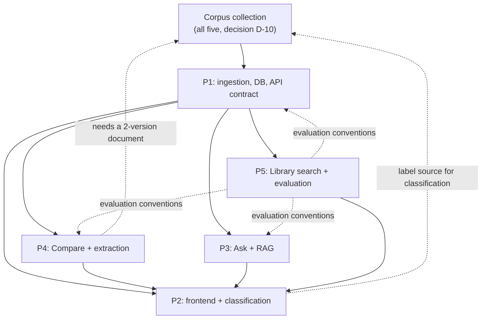

# NiyamSetu — Team Responsibilities

> Written 2026-10-28. Companion to `CLAUDE.md` §7.
>
> **Status:** this is the *proposed* division of work, taken from the project
> brief. No team member has confirmed it in writing in this repository, and no
> member's code exists yet. Where a responsibility needs group agreement it is
> marked **[NEEDS TEAM AGREEMENT]**.
>
> If the team has already decided something differently, update this file rather
> than letting the two diverge. Do not silently reassign anyone's work.

---

## How to read this document

Each person has an **implementation** responsibility (something that runs) and an
**NLP** responsibility (an experiment with a baseline, a comparison and an
evaluation). Both are required. A person who only wires up a UI, or only runs a
pretrained model with no baseline, has not completed their half of the project.

Every NLP responsibility follows the same shape:

```text
baseline method  ->  comparison method  ->  evaluation on a documented sample  ->  error analysis
```

---

## Person 1 — Backend + Document NLP (owner of this repository)

### Implementation
- FastAPI application: routers, Pydantic schemas, error envelope, structured logging.
- PostgreSQL schema: documents, versions, pages, segments, segment_pages, ingestion_jobs.
- Migrations and a reproducible database setup path.
- PDF ingestion: validation, checksum and duplicate detection, per-page extraction,
  normalisation, segmentation, quality checks, single-transaction persistence.
- Endpoints: `/api/health`, `POST /api/documents/ingest`, `GET /api/documents`,
  `GET /api/documents/{id}`, `GET /api/documents/{id}/pages`,
  `GET /api/documents/{id}/clauses`.
- A CLI ingestion path for bulk corpus loading.
- `pytest` suite: unit tests for services, endpoint tests for happy and error paths,
  fixture PDFs.
- The published API contract (`CLAUDE.md` §12) and its change process.

### NLP
- **Experiment A — PDF extraction quality.** Compare extraction libraries on the real
  corpus across clean text, odd formatting, headers/footers, multi-column, tables,
  mid-clause page breaks and scanned pages. Report characters per page, empty pages,
  reading-order errors on a checked sample, header/footer leakage, runtime.
- **Experiment B — paragraph vs clause-aware segmentation.** Build the paragraph
  baseline first. Then clause-aware segmentation using numbering, headings and
  structure. Evaluate on a manually annotated sample: boundary precision / recall / F1,
  exact clause match rate, missed clauses, incorrect merges, incorrect splits, heading
  and numbering preservation, page-provenance correctness.
- **Experiment C — data quality.** Automated checks for empty pages, duplicate files
  and clauses, missing metadata, invalid page references, malformed clause IDs,
  extraction failures, segmentation anomalies, bad version relationships.
- **Experiment D — dataset documentation.** Provenance, authenticity checking,
  inclusion and exclusion criteria, procedure, annotation methodology, limitations,
  reproduction steps.

### Deliverables
1. Working ingestion pipeline. 2. Schema + reproducible setup. 3. Page-aware extracted
content with raw and normalised text. 4. Stored clauses with stable IDs and page
provenance. 5. Documented, tested endpoints. 6. Segmentation comparison with real
numbers. 7. `data/README.md`. 8. Data-quality / extraction evaluation report.
9. Integration instructions for Persons 2–5.

### What I depend on
- **The corpus** (D-10). Nothing in Experiments A–D can be measured without real
  documents and their metadata.
- **A reachable PostgreSQL** on my machine (D-8).
- **A git repository and branch convention** (D-2) before parallel work starts.

### What depends on me
Everything downstream: all four other members consume my clause and document JSON.
**My contract must be frozen before they start coding in earnest**, which is why
`CLAUDE.md` §12 exists ahead of the implementation.

---

## Person 2 — Frontend + Classification NLP

### Implementation
- Streamlit frontend **[NEEDS TEAM AGREEMENT — see `docs/architecture.md` AD-7]**.
- Library interface: browse, search box, filters, recently-added list.
- Document view: metadata, extracted text, page references, clause list, extracted
  entities when Person 4's output is available.
- Navigation between the four areas; loading, error and empty states for every view
  that calls the API.
- Integration through the documented API contract, against a local stub until the
  server exists.

### NLP
- **Document classification.** Baseline: TF-IDF + a linear classifier
  (`scikit-learn` 1.9.1 is available locally). Comparison: an appropriate pretrained
  Transformer. Report accuracy / macro-F1 with the class distribution, a confusion
  matrix, and examples the model gets wrong — not only the headline score.
- **Clustering** (optional, only if it tells us something useful about the corpus).
- **Hindi explanation / generation prototype** — `[PROPOSED]`, scope unconfirmed
  (`CLAUDE.md` D-3). **[NEEDS TEAM AGREEMENT]**

### Deliverables
Working frontend; classification experiment with evaluation; documented methodology;
integration with the backend.

### Open problem to resolve early
**There is no labelled dataset for classification, and none exists in the
repository.** Labels must come from either (a) metadata recorded at corpus
collection time (`document_type`, `department`), or (b) manual labelling by the
team against a written guideline. Option (a) is cheaper and is why
`document_type` is a column in the schema. Decide this in week 1 — it affects what
Person 1 must capture at ingestion.

### Dependencies
- Person 1: document and clause APIs, `document_type` / `department` metadata.
- Person 5: Library search behaviour that the Library UI must present.
- Person 4: entity output rendered in the document view.

---

## Person 3 — Ask Feature + RAG NLP

### Implementation
- The Ask interface end-to-end: question input, answer display, evidence panel.
- Retrieved passages shown with document, version, clause and page references.
- Explicit "insufficient evidence" state in the UI, visually distinct from an answer.

### NLP
- **Baseline retrieval:** BM25 (or TF-IDF cosine) over the clause corpus.
- **Comparison:** dense retrieval with sentence embeddings; then hybrid.
  Report Recall@k and MRR on a question set the team writes.
- **Chunking study:** the same retrieval evaluated over `method='paragraph'` vs
  `method='clause_aware'` segments. This is directly enabled by Person 1 storing
  both; it is one of the project's cleanest experiments.
- **RAG pipeline:** generation constrained to retrieved clauses.
- **Citation correctness test:** for every citation emitted, assert `quote` is a
  verbatim substring of the referenced clause's text. Report the pass rate — this
  number is the project's central reliability claim.
- **Unanswerable questions:** a held-out set of questions the corpus cannot answer.
  Measure how often the system correctly declines.

### Deliverables
Working Ask feature; reusable retrieval + QA module (`nlp/rag_qa/`); retrieval
evaluation; citation reliability test results; unsupported-question handling.

### Hard rule
**Never invent a citation, and never imply a source supports a statement that it
does not.** If retrieval is weak, the correct output is "the available documents do
not answer this", not a plausible paragraph.

### Dependencies
- Person 1: clause corpus with stable IDs and page refs; the citation JSON shape.
- Person 2: where Ask sits in the frontend.
- Person 5: shared evaluation conventions; the question set is best written jointly.

---

## Person 4 — Compare Feature + Information Extraction

### Implementation
- The Compare interface: pick two versions, show aligned clauses side by side.
- Render additions, removals and modifications distinctly.
- Show old and new text, an explanation of the change, and the source references.
- Visually separate confident matches from uncertain ones, and show unmatched
  clauses as unmatched.

### NLP
- **Entity extraction.** Baseline: rules/regex for dates, deadlines, form numbers,
  periodicity ("quarterly", "monthly"), departments and authorities. Comparison: a
  statistical or pretrained NER approach. Evaluate per entity type on an annotated
  sample — precision, recall, F1 — and report which types the rules beat the model on
  (for official date and form-number formats, rules often win; that is a real result
  worth reporting).
- **Obligation detection.** Identify clauses that impose a requirement ("shall",
  "must", "is required to") and, where possible, on whom.
- **Clause alignment across versions.** Candidate pairing by clause number, then by
  lexical and/or semantic similarity. Report alignment accuracy against a manually
  aligned sample.
- **Change classification.** `added` / `removed` / `modified` / `unchanged` /
  `unmatched`, with a confidence value. Evaluate against manual labels.
- **Error analysis.** Where alignment fails: renumbered clauses, merged clauses,
  reordered sections. Document these — they are the honest limitations of the
  headline feature.

### Deliverables
Working comparison module (`nlp/extraction_diff/`); entity extraction experiment;
alignment and change-detection logic; evaluation results and error analysis.

### Coordination required with Person 1 (do this in week 1)
1. Clause schema and the stability guarantee for `clause_id`.
2. Whether `clause_number` is captured as printed (it is, when detected).
3. Document version metadata: `version_label`, `supersedes_version_id`,
   `publication_date` nullability.
4. Page reference semantics for multi-page clauses (`page_start` / `page_end`
   plus the `pages[]` array).
5. Whether extracted entities are stored back into `segments.metadata` or kept in
   Person 4's module — **[NEEDS TEAM AGREEMENT]**; the schema reserves the field
   either way, but the backend currently has no write path for it.

### Dependency warning
Compare needs **at least one document with two real versions** in the corpus. That
is a corpus-collection requirement, not a coding one, and it is easy to discover too
late. Raise it when D-10 is decided.

---

## Person 5 — Library Intelligence + Evaluation and Integration

### Implementation
- Library search and filters, end to end, against the backend.
- Connect document metadata and available NLP outputs into the Library view.
- Coordinate frontend↔backend integration; be the person who notices contract drift.
- Integration and regression tests across the system.

### NLP
- **Search comparison.** Baseline: keyword search (PostgreSQL full-text, or BM25
  over document text). Comparison: semantic or hybrid document search. Evaluate on a
  query set with relevance judgements the team writes; report Precision@k, nDCG or MRR
  with the judgement procedure stated.
- **Error-propagation analysis.** The most interesting experiment in the project:
  take documents where Person 1's extraction or segmentation is known to be poor, and
  measure how much worse search and Ask perform on them versus clean documents. This
  connects everyone's work and is strong viva material.
- **Shared evaluation procedure.** Define the report format, sampling conventions,
  where annotations live, and how results are regenerated. Everyone conforms to it.
- **End-to-end evaluation.** Walk real user tasks through the whole system and record
  what breaks.

### Deliverables
Working Library search; search relevance evaluation; integration and regression tests;
end-to-end evaluation report; a documented list of errors and limitations.

### Dependencies
- Person 1: searchable metadata, clause text, full-text index.
- Person 2: the Library UI that surfaces search.
- Persons 3 and 4: their outputs, for the end-to-end evaluation.

### Explicit note
Person 5 is **not** a project manager. The search implementation and the
error-propagation study are real, gradable technical work. Integration coordination
is in addition to that, not instead of it.

---

## Cross-team dependency map



Read this as: **the corpus blocks Person 1, and Person 1's contract blocks
everyone else.** Those are the two things to unblock first.

---

## Shared contracts (all five must agree)

| # | Contract | Defined in | Owner |
|---|---|---|---|
| 1 | `document_id`, `version_id`, `clause_id` formats | `CLAUDE.md` §12 | P1 |
| 2 | Page references: 1-based, inclusive | `CLAUDE.md` §12 | P1 |
| 3 | Clause JSON shape | `CLAUDE.md` §12.3 | P1 |
| 4 | Document JSON shape | `CLAUDE.md` §12.3 | P1 |
| 5 | Endpoint names and paths | `CLAUDE.md` §12.3 | P1 |
| 6 | Error envelope and codes | `CLAUDE.md` §12.1 | P1 |
| 7 | NLP module input/output JSON | `docs/architecture.md` §2.4 | each module owner |
| 8 | Citation format | `CLAUDE.md` §12.2 | P1 defines, P3/P4 emit |
| 9 | Dataset and annotation file formats | `data/README.md` | P1, with P5 |
| 10 | Evaluation report format and location | `evaluation/` | P5 |

---

## Decisions that require the whole team

1. **D-1** Monorepo, or separate repositories per member.
2. **D-2** Initialise git; choose the remote and branch convention.
3. **D-3** Is Hindi / simple-language output a graded deliverable or a stretch demo?
4. **D-7** Where retrieval embeddings live; whether any vector store is introduced.
5. **D-10** Which documents form the corpus, who collects them, and what metadata is
   recorded at collection time.
6. Frontend framework confirmation (AD-7), given Compare's side-by-side UI needs.
7. Whether extracted entities are written back into `segments.metadata`.
8. The question set and relevance judgements for Ask and Library evaluation —
   these should be written jointly so they are not tuned to one person's system.

Full decision table with recommendations: `CLAUDE.md` §22.2.
